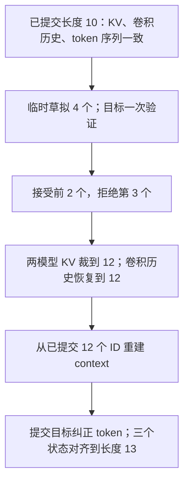

# 解码时到底要记住什么？

把一段文本从头重算最容易保证正确，但很慢。缓存的目标是复用已经完成的工作；
**只保存部分历史、或者回滚时只删掉部分状态，都可能悄悄改变后续结果。**

## 三份历史，三个用途

| 状态 | 来源和用途 | 需要保存多少 |
|---|---|---|
| 注意力 K/V | 每层把前文投影后的 key/value，供新 query 读取 | 当前实现保留整个已提交序列 |
| n-gram token 历史 | 用 token ID 计算 Engram 的哈希索引 | 每个新 chunk 加前 N−1 个 ID |
| ShortConv 激活历史 | 已经经过当前层门控的记忆 value，用于因果卷积 | H=(kernel_size−1)×dilation 个激活 |

例如 N=3、卷积 kernel=4、dilation=3：哈希只要前 **2 个 ID**，卷积却要前
**9 个激活**。它们不是同一种东西。卷积激活依赖 hidden state 和 gate，
不能把前两个 token ID 当成它的替代品。

## 一次拒绝如何回滚

假设已经提交 10 个 token，草拟 4 个，前两个被接受，第三个被拒绝：



目标模型一次处理整个草稿 chunk，所以缓存暂存“旧 H 个激活＋整个新 chunk”，
可恢复到该 chunk 的任意前缀。草稿模型是分多次 forward 运行的，
因此每次草拟保存一份**很小的卷积状态快照**，拒绝后选择对应接受位置的快照。
这也适用于草拟长度超过 H 的情况。

不要仅裁 KV 后继续使用末尾的卷积状态；其中可能含有已拒绝 token 的激活。

## API 没有藏在模型内部

模型仍然返回 `(logits, loss, cache)`，且 `cache[i]` 仍然可解包为 `(K,V)`。
额外状态放在这个请求自己的 `KVCache` 对象里，不写入模型的全局可变缓冲区，
不同请求不会共享历史。

```python
logits, _, cache = model(prompt)
logits, _, proposed_cache = model(
    proposals, caches=cache, position_offset=prompt.shape[1],
    context_ids=torch.cat([prompt, proposals], dim=1),
)
committed_cache = proposed_cache.crop(prompt.shape[1] + accepted)
```

`cache.conv_states[i]` 是下次 forward 需要的有界原始门控激活。
`cache.conv_windows[i]` 保留最近一次 forward 的回滚材料，至多 H+本轮输入长度。
`crop()` 不会原地修改原来的 cache。如果跨越多个独立 forward 回滚，
必须提供那一位置保存的 `conv_states` 快照；否则会明确报错。
`list(cache)` 只留下 KV，会丢卷积历史，不能这样转换 Engram 缓存。

完整训练 forward 的默认返回接口仍相同，梯度也能回到历史卷积 tap。
参考实现和 `src/` 骨架公开签名同步；缓存容器是提供好的基础设施，原有关卡 TODO 保留。

## 为什么局部查表更合理

对于长度为 L 的历史、T 个新输入：

```text
旧路径：对 L 个 token 哈希 -> gather L 个位置 -> 只取最后 T 个
新路径：对最多 T+N-1 个 token 哈希 -> 只 gather 最后 T 个位置
```

旧 ID 参与哈希，但它们的 embedding 不需要再次读取。压缩 tokenizer 也只处理局部 ID。
这减少的是 Engram 检索的重复工作；注意力仍读取历史 KV，不能据此宣称整个解码变为 O(1)。

## 如何验证自己真的实现对了

```bash
TINYENGRAM_IMPL=solutions python -m pytest -q tests/test_decode_state.py
```

测试使用**非零历史卷积权重**，比较逐 token、多个 chunk、拒绝后继续解码和完整重算；
分别检查两模型每层 KV 和卷积状态，同时检查长历史下的哈希/gather 工作量。
还检查普通训练反传，以及错误位置、丢失 token 历史和丢失卷积缓存会明确报错。

“输出暂时一样”不够；零初始化可能隐藏状态错误。先检查完整状态，再谈时延。
